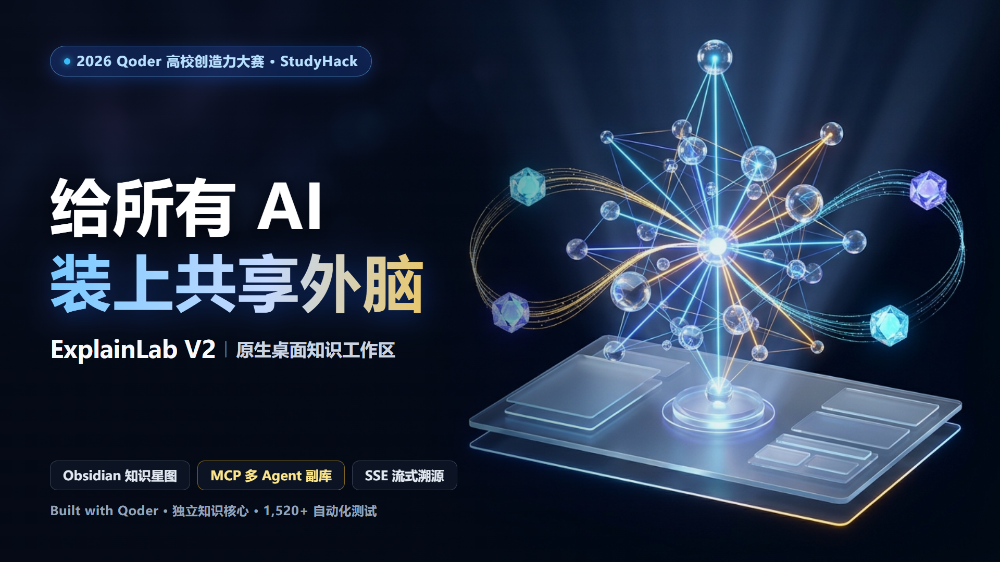

# Nesti · AI 工作空间（ExplainLab V3）

[](https://github.com/wzzwanererer-netizen/ExplainLab/actions/workflows/ci.yml)
[](https://github.com/wzzwanererer-netizen/ExplainLab/releases/latest)
[](LICENSE)



> **给电脑里所有 AI 助手装上同一个本地「长期海马体」** · 100% 本地隐私、跨 22 款主流 AI 助手共享记忆、乱文件夹资产化管理、一键生成办公成品、以及可扩展的 Theme Studio 2.0 风格插件工坊。

- **产品官网**：https://wzzwanererer-netizen.github.io/ExplainLab/
- **Windows 一键体验包**：https://github.com/wzzwanererer-netizen/ExplainLab/releases/latest
- **演示视频（B站）**：https://www.bilibili.com/video/BV1dgykzrE7h/

| 平台 | 支持状态 | 启动方式 |
| :--- | :--- | :--- |
| **Windows 10 / 11** | ✅ 真机完整验证 | 下载 Release 一键体验包，双击 `一键启动-Nesti工作空间.bat` |
| **macOS (Apple Silicon / Intel)** | 🧪 跨平台源码支持（GitHub Actions `macos-latest` CI 验证） | 克隆仓库后运行 `chmod +x start-nesti.sh scripts/explainlab-mcp.sh && ./start-nesti.sh` |
| **Linux (Ubuntu / WSL2 等)** | 🧪 跨平台源码支持（GitHub Actions `ubuntu-latest` CI 验证） | 克隆仓库后运行 `chmod +x start-nesti.sh scripts/explainlab-mcp.sh && ./start-nesti.sh` |

---

## 为什么做 Nesti / ExplainLab V3？

你电脑里可能同时装了 Claude Code、Cursor、Codex、Antigravity、Trae、CodeBuddy、Qoder、豆包工作、千问办公……但它们彼此孤立，过几天就「金鱼脑失忆」；桌面和下载文件夹里也堆满了散落的 Word / PDF / PPT / Excel。

**ExplainLab V3（Nesti · AI 工作空间）** 就是为此而生的 **本地 AI 长期记忆中枢 + 个人知识资产工作台**。

---

## 核心特性（V3 完整版）

1. **多 Agent 统一记忆外脑（支持 22 款主流 AI 助手 + MCP 共享记忆）**
   - 内置标准 MCP Server（JSON-RPC 2.0 over stdio），支持一键接入 **Antigravity、Claude Code、Cursor、Codex、Trae CN、CodeBuddy、WorkBuddy、Qoder、Kimi、QwenWork、DSH、OpenCode、GitHub Copilot** 等主流助手；
   - 每个外部 Agent 自动拥有独立副库（`Agent · xxx`），与个人主知识库隔离，同时支持 **自动对话吸尘**、**自选对话精炼入库** 与 **跨 Agent 只读无缝接力**（零污染知识库）；
   - **任务完成临时悬浮弹窗**：AI 助手完成任务后右下角自动滑出透明悬浮窗询问是否入库，不抢焦点、不点 12 秒自动消失。

2. **全局快捷键「一键闪记」（`Alt + Shift + Space`） & 网址一键剪藏**
   - 在电脑任意软件里按下 `Alt + Shift + Space` 呼出居中极简悬浮输入条：支持文字灵感、`Ctrl + V` 粘贴截图秒存附件，粘贴 `https://` 链接自动触发 **网址一键剪藏**（剥离杂乱脚本/导航，转为干净 Markdown 卡片）。

3. **一键生成办公成品（支持自选保存目录）**
   - 纯本地零重依赖生成，无需安装 Office：在知识库顶部或卡片右键一键生成 **总结报告 PDF (.pdf)**、**16:9 汇报演示 PPT (.pptx)**、**可编辑 Word (.docx)** 与 **高清知识卡片长图 (.png)**。

4. **乱文件夹哨兵 + 内置文件资产库**
   - 只读监听本机桌面/下载等杂乱目录，一键收编 Word / Excel / PPT / PDF / ZIP / 图片 / 音视频（不搬运原文件）；
   - 内置 **原位阅读器**（Word/Excel/PPT/PDF/音视频直接看），右键一键在 Windows 资源管理器中精确定位。

5. **Obsidian 风格力导向知识星图 & 知识治理**
   - 多色 Agent/专题聚类 + 自动发现隐性关联连线，点击节点跨空间高亮定位到知识库；
   - 支持 **卡片批量管理**（多选批量生效 / 批量移动空间 / 批量删除）、`[[双链]]` 自动补全、版本回滚与审核门禁（Review Queue）。

6. **Theme Studio 2.0 · UI 风格插件工坊**
   - 内置 6 套整站皮肤：**Nesti Fluent（官方默认）**、**未来赛博（Cybernetic Terminal）**、**复古图书馆（Classical Library）**、**极简墨水屏（E-Ink Zen）**、**森系护眼（Nordic Matcha）**、**爵士黑金（Noir Gold）**；
   - 支持 **「AI 一句话生成专属风格」**、**零代码可视化风格制作器** 与 `.nesti-style.json` 风格插件导入导出。

7. **全原生 Windows 桌面体验**
   - Electron 无边框集成标题栏 + 系统托盘常驻 + 开机静默自启 + `Ctrl + K` 全局瞬搜 + 可视化「模型与 Key 设置」（支持 DeepSeek、通义千问、智谱 GLM、Kimi、SiliconFlow 及本地免费 Ollama）。

---

## 架构概览

```text
外部 Agent 生态 (22 款主流 AI 助手 · Claude / Cursor / Codex / Antigravity / Trae / CodeBuddy ...)
        │  MCP (JSON-RPC 2.0 over stdio) + 本地会话只读接力
        ▼
  ExplainLab MCP Server ──┐
                          ├──HTTP + SSE /api──▶ FastAPI Backend (SQLAlchemy 2 + Alembic + 双库方言适配)
  Nesti 原生桌面端 ───────┘                              │  Protocol 端口注入
  (Electron + Theme Studio 2.0)                          ▼
                                            knowledge-core (纯 Python 领域核心，零 Web/ORM 依赖)
                                                         │
                                                         ▼
                                      SQLite FTS5 (桌面默认) / PostgreSQL tsvector (部署目标)
```

---

## 快速开始（Windows / macOS / Linux）

### 环境要求
- Python `3.11+` + [uv](https://docs.astral.sh/uv/)
- Node.js `>= 22.23.2`

### 1. 安装依赖与初始化数据库
```bash
# 安装 Python 后端与独立核心依赖（国内可加 UV_INDEX_URL=https://pypi.tuna.tsinghua.edu.cn/simple）
uv sync --locked

# 复制配置模板（也可启动后在软件「模型与 Key 设置」页面可视化配置）
cp backend/.env.example backend/.env

# 初始化本地 SQLite 数据库
cd backend && uv run alembic upgrade head
```

### 2. 启动原生 Electron 桌面端（推荐）
```bash
cd frontend && npm ci && npm run build
cd ../desktop && npm ci && npm start
```

### 3. 开发模式（Web 浏览器）
```bash
# 终端 1：启动 FastAPI 后端（http://127.0.0.1:8000）
cd backend && uv run uvicorn app.main:app --reload

# 终端 2：启动前端（http://localhost:5173）
cd frontend && npm ci && npm run dev
```

### 4. 接入本机 AI 助手（MCP）
详见 [docs/agent-mcp-setup.md](docs/agent-mcp-setup.md)，在任意支持 MCP 的客户端配置 `scripts/explainlab-mcp.cmd` 即可共享长期记忆。

---

## 测试与质量保障

```bash
# 后端 + knowledge-core 根级全量测试
uv run pytest -o addopts="--import-mode=importlib"

# 代码检查
uv run ruff check

# 前端单元测试、类型检查与构建（79 项）
cd frontend && npm run test && npm run typecheck && npm run build
```

---

## License

本项目采用 [MIT License](LICENSE) 开源。欢迎提交 Issue、PR 或分享你创作的 `.nesti-style.json` UI 风格插件！
