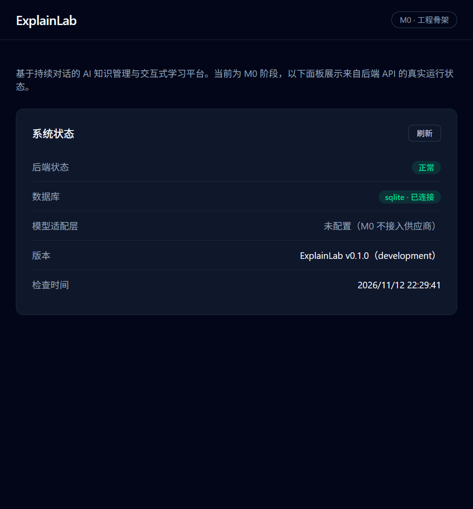

# M0 验收报告 · 项目初始化与工程规范建立

- 日期：2026-11-12
- 阶段：M0（工程骨架，不含业务功能）
- 结论：**通过**。14 项任务全部完成，前后端、数据库、测试均已实际运行验证。

## 1. 环境

| 项 | 实测值 |
|---|---|
| 工作区 | `D:\ExplainLab`（初始为空目录，无已有文件被改动） |
| 操作系统 | Windows（Git Bash + PowerShell 双脚本支持） |
| Node / npm | v22.23.2 / 10.9.8 |
| Python | 3.11.9（uv 选用本机 `D:\Dev\Python\Python311`，项目级 `.venv`，未改系统环境） |
| uv | 0.13.6 |
| SQLite | 3.40.1，FTS5 实测可用 |
| Git | 2.55.0.windows.5 |

## 2. 任务完成清单

| # | 任务 | 状态 | 证据 |
|---|---|---|---|
| 1 | 检查工作区 | ✅ | 空目录确认，见第 1 节 |
| 2 | 初始化前端工程 | ✅ | Vite 8 + React 19 + TS 7 + Tailwind 4，构建通过（§3.4） |
| 3 | 初始化后端工程 | ✅ | FastAPI 0.162 + SQLAlchemy 2.1 + Pydantic 2.14，服务实际运行（§3.5） |
| 4 | Knowledge Core 独立模块骨架 | ✅ | 独立包，子进程导入闭包测试证明无 Web 框架依赖（§3.3） |
| 5 | Model Adapter 接口 | ✅ | ABC + 类型 + 注册工厂，无具体供应商（§3.3） |
| 6 | 配置 SQLite | ✅ | `backend/data/explainlab.db` 实际创建，健康检查真实连通（§3.5） |
| 7 | PostgreSQL 连接支持 | ✅ | psycopg 3.3.9 驱动 + URL 方言切换，引擎装配与降级路径测试通过（§3.3） |
| 8 | 配置 Alembic | ✅ | `upgrade head` 实际执行，版本 `0001_baseline (head)`（§3.2） |
| 9 | 前后端通信 | ✅ | 直连与 Vite 代理双链路真实请求 + 浏览器截图（§3.5、§3.6） |
| 10 | 健康检查 API | ✅ | `GET /api/health` 真实执行 `SELECT 1`（§3.5） |
| 11 | 配置 Git | ✅ | main 分支初始化 + 初始提交（§5） |
| 12 | 项目文档 | ✅ | README / MILESTONES / architecture / development |
| 13 | 基础测试 | ✅ | Python 38 通过 + 前端 5 通过 + ruff 通过（§3.3、§3.4） |
| 14 | 本地启动脚本 | ✅ | setup / dev / test 双版本，setup 与 test 已端到端实跑（§3.7） |

## 3. 实际运行证据

### 3.1 依赖安装

`uv sync`：40 个包安装成功，关键版本：

```
fastapi==0.162.5  sqlalchemy==2.1.8  alembic==1.20.1  pydantic==2.14.3
pydantic-settings==2.16.2  psycopg==3.3.9  uvicorn==0.54.0
pytest==9.2.0  pytest-asyncio==1.4.1  ruff==0.17.4
knowledge-core==0.1.0 (workspace 可编辑安装)
explainlab-backend==0.1.0 (workspace 可编辑安装)
```

`npm install`：128 个包，0 漏洞。关键版本：

```
react 19.3.1  @xyflow/react 12.12.1（React Flow）  elkjs 0.12.1
vite 8.3.8  typescript 7.0.2  tailwindcss 4.3.5  vitest 5.1.0
```

### 3.2 数据库迁移

```
$ cd backend && uv run alembic upgrade head
INFO  [alembic.runtime.migration] Context impl SQLiteImpl.
INFO  [alembic.runtime.migration] Running upgrade  -> 0001_baseline
$ uv run alembic current
0001_baseline (head)
```

### 3.3 Python 测试与 lint

```
$ uv run pytest
38 passed in 2.57s

$ uv run ruff check backend knowledge-core
All checks passed!
```

覆盖：配置解析（SQLite 默认 / PostgreSQL URL / 环境变量覆盖）、健康检查（正常 / 数据库不可达降级 / 供应商配置上报）、引擎工厂（含 PG 方言装配，不依赖真实 PG 服务器）、SQLite 文件库自动建目录、**FTS5 建表与 MATCH 查询实测**、Alembic 在临时库真实迁移、领域实体校验、五大服务接口抽象契约、Model Adapter 注册工厂、**Knowledge Core 子进程导入闭包无 fastapi/starlette/flask/django**。

### 3.4 前端测试与构建

```
$ npm run test
Test Files  2 passed (2)   Tests  5 passed (5)

$ npm run build   # tsc -b && vite build
✓ 18 modules transformed.
dist/index.html                   0.39 kB
dist/assets/index-RmKoGgck.css    8.83 kB   # Tailwind 真实生成
dist/assets/index-C2NAhkVj.js   223.09 kB
✓ built in 118ms
```

### 3.5 前后端通信（服务实际运行中）

直连后端：

```
$ curl http://127.0.0.1:8000/api/health
{"status":"ok","app":"ExplainLab","version":"0.1.0","environment":"development",
 "database":{"connected":true,"dialect":"sqlite","error":null},
 "model_adapter":"not_configured","timestamp":"2026-11-12T14:29:20.356778Z"}
HTTP 200
```

经 Vite 代理（前端同源路径）：

```
$ curl http://localhost:5173/api/health
{"status":"ok", ... "database":{"connected":true,"dialect":"sqlite"} ...}
```

两条链路返回一致的真实数据库探测结果。`model_adapter: not_configured` 为如实状态，非假数据。

### 3.6 浏览器实测

浏览器打开 http://localhost:5173 ，首页面板真实渲染：后端状态「正常」、数据库「sqlite · 已连接」、模型适配层「未配置（M0 不接入供应商）」、版本与检查时间。



### 3.7 启动脚本端到端实跑

```
$ bash scripts/setup.sh   # uv sync + npm install + alembic upgrade head，全部成功
$ bash scripts/test.sh    # pytest 38 通过 + ruff 通过 + vitest 5 通过 + 构建成功
全部通过
```

`dev.sh` / `dev.ps1` 用于日常启动（本次验收以等价命令实际启动了前后端服务）。

## 4. 架构约束遵守情况

- Knowledge Core 为独立 Python 包，仅依赖 Pydantic；有自动化测试守护其独立性，未来可直接复用于 Nesti。
- 知识提取 / 关系 / 版本 / 来源 / 检索均为接口定义，未提前实现业务功能。
- Model Adapter 仅有抽象接口与注册工厂，无任何供应商实现与 Key。
- 前端无任何密钥；`.env` 已 gitignore，仅提交 `.env.example`。
- 未生成业务页面，首页仅真实健康状态面板；无假数据。
- 未删除工作区任何已有文件（初始为空）。

## 5. Git

- `git init -b main`，初始提交包含全部工程文件、`uv.lock`、`frontend/package-lock.json` 与验收证据。
- 忽略项：`.venv/`、`node_modules/`、`dist/`、`data/`、`.env`、缓存等。

## 6. 已知限制与遗留事项（不影响 M0 验收）

1. PostgreSQL 仅完成驱动 + 配置 + 方言测试，未安装真实 PG 服务器（按 M0 范围）；部署阶段按 `docs/development.md` 切换。
2. React Flow / ELK.js 依赖已就绪并通过构建，地图 UI 属 M4。
3. 第三方警告：starlette 1.10 提示 `httpx` TestClient 未来迁移 `httpx2`，仅警告，不影响功能；后续版本跟进。
4. Windows GBK 控制台下迁移日志中文显示为乱码，仅显示问题，数据与功能正常；`alembic.ini` 已保持 ASCII 以规避 locale 解码问题。
5. `dev.sh` 在 Git Bash 下 Ctrl+C 可能残留子进程，Windows 日常开发推荐 `dev.ps1`（独立窗口，关闭即停）。

## 7. 验收结论

M0 全部 14 项任务完成并经实际运行验证，工程骨架可运行、可测试、可扩展，架构约束全部满足。**建议通过验收，进入 M1。**