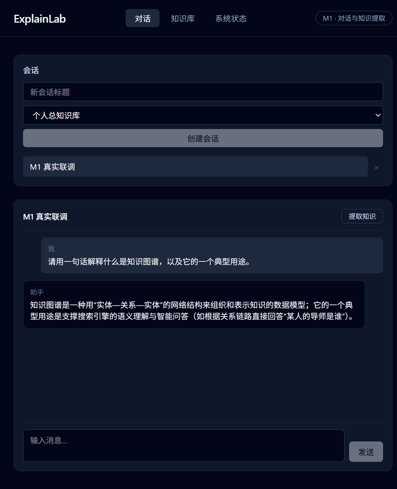
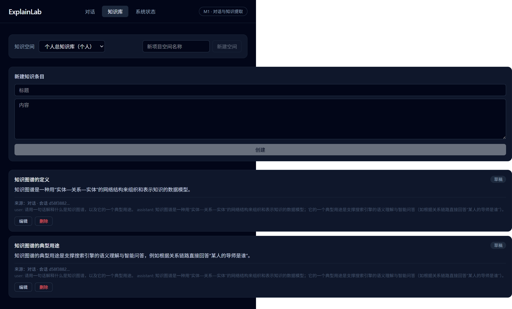
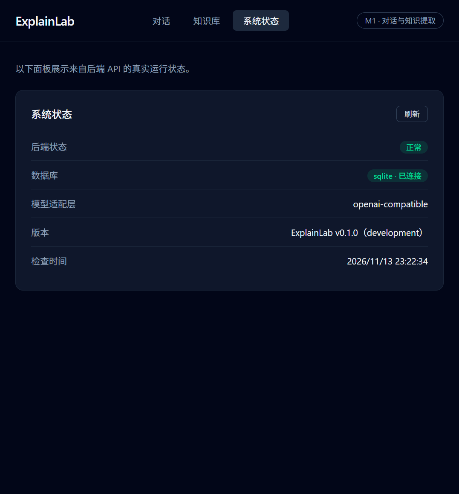

# M1 验收报告 · 对话与知识提取基础

- 日期：2026-11-13
- 阶段：M1（对话与知识提取基础）
- 结论：**通过**。会话对话、知识提取与持久化、知识空间 CRUD 全部完成，并已接入真实模型（DeepSeek，OpenAI 兼容端点）端到端联调；前后端、数据库、测试均实际运行验证。

## 1. 范围与目标

按 MILESTONES.md，M1 目标：

1. 会话模型与对话 API（接入首个模型供应商，通过 Model Adapter）。
2. Knowledge Core：知识提取服务实现、知识条目持久化。
3. 个人总知识库 / 项目知识空间的数据模型与基本 CRUD。

首个供应商选定 **OpenAI 兼容接口（DeepSeek）**，密钥由用户自行写入 `backend/.env`，全程不经过对话、不进入前端。

## 2. 任务完成清单

| # | 任务 | 状态 | 证据 |
|---|---|---|---|
| 8 | Knowledge Core：适配器 + 提取服务 + 知识工作流 | ✅ | OpenAICompatibleAdapter / LLMExtractionService / KnowledgeService（§3.1、§3.3） |
| 9 | 数据层：ORM 模型与迁移 0002 | ✅ | 5 张 M1 表，`0002_m1_core (head)`，无漂移（§3.2） |
| 10 | Backend：仓库实现与 API 装配 | ✅ | KnowledgeRepository 端口实现 + spaces/conversations/knowledge 路由（§3.5） |
| 11 | Frontend：对话与知识库两个视图 | ✅ | ChatView / KnowledgeView / HealthPanel，3 个页签（§3.6） |
| 12 | M1 全量测试 | ✅ | Python 80 通过 + 前端 15 通过 + ruff 通过（§3.3、§3.4） |
| 13 | 安装依赖与自动化验证 | ✅ | 迁移、测试、构建实跑（§3） |
| 14 | 真实模型联调与 M1 验收 | ✅ | DeepSeek 真实对话 + 提取 2 条知识并落库（§3.5、§3.6） |

## 3. 实际运行证据

### 3.1 Knowledge Core（独立于前端与 Web 框架）

- **Model Adapter**：`ModelAdapter` 抽象基类 + 供应商无关类型（`ModelRequest/ModelResponse/ModelMessage/TokenUsage/ModelCapability`）+ `AdapterRegistry` 注册工厂。首个实现 `OpenAICompatibleAdapter`（httpx），覆盖任意 OpenAI Chat Completions 兼容端点；`base_url/api_key/model` 由调用方注入，核心不读环境变量。
- **知识提取**：`LLMExtractionService` 调用模型解析 JSON 抽取知识条目，解析失败如实返回空列表（不造假）；`KnowledgeService.extract_and_store` 编排「提取 → 逐条持久化」，随条目写入来源追溯（`SourceRef`：conversation_id + excerpt）。
- **持久化端口**：`KnowledgeRepository` Protocol 由应用层注入实现，核心不绑定数据库。
- **独立性守护**：子进程导入闭包测试证明核心不依赖 fastapi/starlette/flask/django，可直接复用于 Nesti。

### 3.2 数据库迁移

```
$ cd backend && uv run alembic current
0002_m1_core (head)

$ uv run alembic check
No new upgrade operations detected.   # ORM 与迁移无漂移
```

M1 新增 5 张表：`knowledge_spaces`、`conversations`、`messages`、`knowledge_items`、`source_refs`（UUID 以 String(36) 存储；SQLite 批处理模式渲染）。

### 3.3 Python 测试与 lint

```
$ uv run pytest backend/tests knowledge-core/tests
80 passed in 7.61s

$ uv run ruff check backend knowledge-core
All checks passed!
```

覆盖（M1 新增）：OpenAI 兼容适配器请求/响应/错误/向量排序（httpx.MockTransport，不发真实网络请求）、**环境代理与 IPv6 NO_PROXY 回归**、提取服务解析与来源追溯、知识工作流编排、空间/会话/知识 API CRUD、模型未配置 503、对话失败回滚不落库、提取来源追溯、**个人总知识库聚合未归属条目**、迁移版本与表存在性。

### 3.4 前端测试与构建

```
$ npm run test
Test Files  4 passed (4)   Tests  15 passed (15)

$ npm run build   # tsc -b && vite build
✓ 20 modules transformed.
dist/index.html                   0.39 kB
dist/assets/index-DqNzjdCG.css   13.65 kB   # Tailwind 真实生成
dist/assets/index-jOeL8VyY.js   236.18 kB
✓ built in 103ms
```

### 3.5 真实模型端到端联调（服务实际运行中）

模型配置：`MODEL_PROVIDER=openai-compatible`、`MODEL_BASE_URL=https://api.deepseek.com/v1`、`MODEL_NAME=deepseek-chat`，密钥仅存于 `backend/.env`（gitignore）。

真实对话（`POST /api/conversations/{id}/chat`，模型真实回复并落库）：

```
user:      请用一句话解释什么是知识图谱，以及它的一个典型用途。
assistant: 知识图谱是一种用“实体—关系—实体”的网络结构来组织和表示知识的数据模型；
           它的一个典型用途是支撑搜索引擎的语义理解与智能问答（如根据关系链路直接
           回答“某人的导师是谁”）。
```

真实提取（`POST /api/conversations/{id}/extract`）返回 `count=2`，两条均为模型真实输出、状态 `draft`、来源 `conversation` 并携带 conversation_id 与原文 excerpt：

```
- 知识图谱的定义：知识图谱是一种用“实体—关系—实体”的网络结构来组织和表示知识的数据模型。
- 知识图谱的典型用途：支撑搜索引擎的语义理解与智能问答，例如根据关系链路直接回答“某人的导师是谁”。
```

持久化复核（`GET /api/knowledge`）确认 2 条已入库；个人总知识库视图（`GET /api/knowledge?space_id=<personal>`）同样返回这 2 条（见 §4 语义修正）。

模型未配置时如实返回 503 并附配置指引；模型调用失败如实返回 502，失败请求回滚不落库。

### 3.6 浏览器实测

浏览器打开 http://localhost:5173 ，三个页签真实渲染，数据均来自后端真实 API：

- **对话**：会话列表含真实联调会话「M1 真实联调」，线程展示真实用户/助手消息，可发送与提取知识。
- **知识库**：默认选中「个人总知识库（个人）」，展示上述 2 条提取所得知识条目（草稿状态 + 来源追溯），支持手动新建/编辑/删除与项目空间切换。
- **系统状态**：后端「正常」、数据库「sqlite · 已连接」、模型适配层「已配置」（真实探测）。







## 4. 联调中发现并修复的问题

1. **httpx 环境代理缺陷（真实对话 HTTP 500）**：httpx 0.28 在 `trust_env=True` 时解析 `NO_PROXY` 中的 IPv6 项（如 `[::1]`）抛 `InvalidURL: Invalid port: ':1]'`。修复：适配器 `trust_env=False`，直连调用方给定的真实 `base_url`，既规避该缺陷，也杜绝任何环境代理替换（符合 URL 约束）。已补回归测试。
2. **个人总知识库视图为空（语义不一致）**：领域语义中 `KnowledgeItem.space_id=None` 即个人总知识库，而无空间会话提取所得条目 `space_id=None`；前端按已 seeding 的个人空间具体 id 过滤，导致这些条目不显示。修复：仓库端口 `list` 增加 `include_unassigned` 选项（向后兼容），个人空间视图聚合 `space_id=None` 条目，项目空间视图不受影响。已补回归测试，并经真实 API 复核（个人视图返回 2 条）。

## 5. 架构约束遵守情况

- Knowledge Core 仍为独立 Python 包，仅依赖 Pydantic + httpx；提取/持久化/来源追溯经由端口与接口，不依赖前端页面，可复用于 Nesti（独立性测试守护）。
- 模型供应商仅通过 Model Adapter 接入，可替换；核心不读密钥环境变量。
- API Key 仅存于 `backend/.env`（gitignore），前端无任何密钥；仅提交 `.env.example`。
- 所有展示数据来自真实 API 与真实模型输出，无假数据；模型未配置/失败均如实上报。
- 模型请求只发往用户给定的真实 `MODEL_BASE_URL`（https://api.deepseek.com/v1），`trust_env=False`，无任何代理替换。
- 未删除工作区任何已有文件；未擅自改变技术架构。

## 6. Git

- 本次提交包含：Knowledge Core 适配器/提取/工作流与端口、后端 ORM/迁移 0002/仓库实现/服务/路由/DTO/依赖、前端两视图与 API 客户端、全量测试、`backend/.env.example`、M1 验收报告与截图、MILESTONES.md 更新。
- 忽略项：`.venv/`、`node_modules/`、`dist/`、`data/`、`.env`、缓存等（`.env` 绝不入库）。

## 7. 已知限制与遗留事项（不影响 M1 验收）

1. 知识去重、关系推断、版本管理、审核流属 M2；混合检索属 M3；知识地图属 M4；交互实验属 M5。本阶段未提前开发。
2. 提取结果质量依赖模型输出，解析失败如实返回空列表；结构化抽取提示词后续可按需打磨。
3. 向量检索能力（`embed`）已在适配器实现并就绪，检索编排属 M3。
4. 第三方警告：starlette TestClient 提示未来迁移 `httpx2`，仅警告，不影响功能。

## 8. 验收结论

M1 全部任务完成并经实际运行与真实模型端到端验证：对话可真实生成并落库、知识可真实提取并持久化且来源可追溯、个人/项目空间 CRUD 可用，架构约束全部满足。**建议通过验收，进入 M2。**