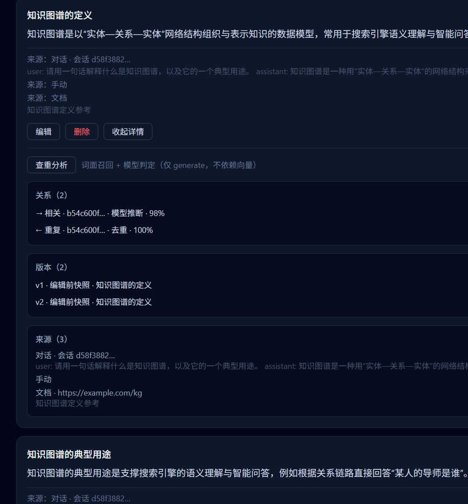
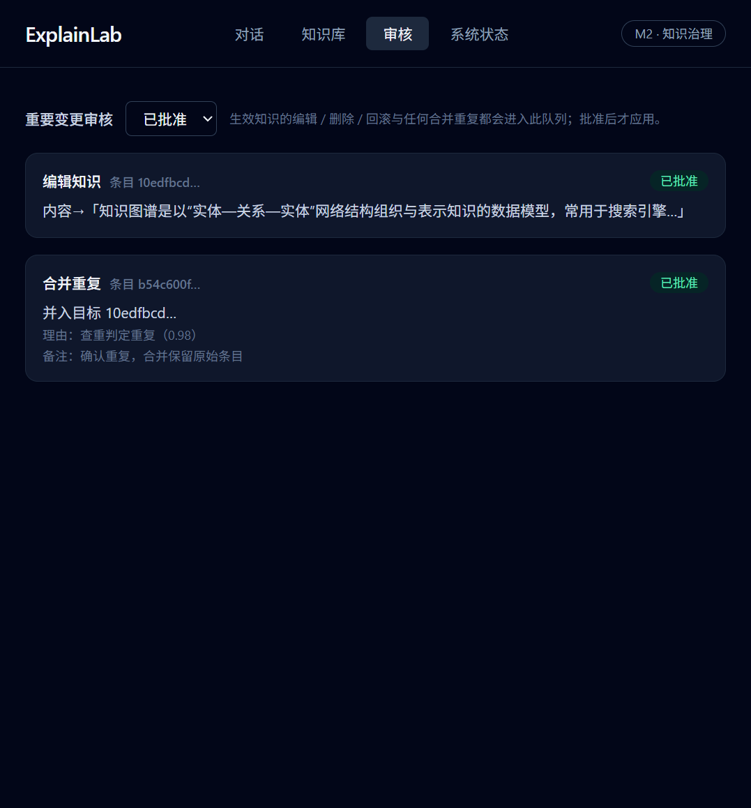

# M2 验收报告 · 知识关系、去重与审核

- 日期：2026-11-14
- 阶段：M2（知识治理层）
- 结论：**通过**。去重（词面 + LLM）、关系推断、版本管理、来源追溯落地、重要变更审核流全部完成，治理逻辑全部落在独立的 Knowledge Core；并已用真实模型（DeepSeek，OpenAI 兼容端点，仅 `generate`）端到端联调验证治理闭环。前后端、数据库、迁移、测试均实际运行验证。

## 1. 范围与目标

按 MILESTONES.md 与 [M2 实施计划](../plans/M2-plan.md)，M2 在 M1「提取 + 持久化 + 空间」之上补齐四大治理能力：

1. 重复知识识别、知识关系推断（来源 / origin 可追溯）。
2. 版本管理与来源追溯落地。
3. 重要知识变更审核流（提交 → 批准 / 驳回，合并闭环）。
4. 上述能力的最小 API 与前端界面。

关键供应商约束：**DeepSeek 的 OpenAI 兼容端点不提供 `/embeddings`**。M2 所有模型调用只用 `generate`（去重判定、关系推断）；去重候选召回用纯 Python 词面相似度（不建检索索引），语义向量去重留到 M3。未提前开发 M3 检索 / M4 地图 / M5 实验。

## 2. 任务完成清单

| # | 任务 | 状态 | 证据 |
|---|---|---|---|
| T1 | 领域新增 + 端口 + ORM + 迁移 0003 | ✅ | ReviewStatus/ReviewAction/ReviewRequest/RelationOrigin；3 个仓库端口；3 张治理表，`0003_m2_governance (head)` 无漂移（§3.1、§3.2） |
| T2 | Core 词面 + LLMRelationService | ✅ | lexical char-bigram 余弦召回 + LLM 同一知识判定 / 关系推断（§3.1、§3.5） |
| T3 | Core VersionService + ProvenanceService | ✅ | create/list/restore（线性历史）；attach/trace（§3.1） |
| T4 | Core ReviewPolicy + ReviewService | ✅ | 审核矩阵 + submit/approve/reject/merge 编排（§3.1、§4） |
| T5 | Backend 仓库实现 + 服务装配 + API | ✅ | SQLAlchemy 三仓库 + governance 路由 + PATCH/DELETE 经审核（§3.5、§5） |
| T6 | Frontend 最小界面 | ✅ | 详情关系/版本/来源、查重合并、审核页签、202 提示（§3.6） |
| T7 | 全量测试 + lint + 构建 + 无漂移 | ✅ | Python 117 + 前端 27 + ruff + build + alembic 无漂移（§3.3、§3.4） |
| T8 | 真实模型联调 + 验收报告 + MILESTONES + 提交 | ✅ | DeepSeek 真实治理闭环证据（§3.5）+ 本报告 + MILESTONES M2 ✅ + Git 提交 |

## 3. 实际运行证据

### 3.1 Knowledge Core（独立于前端与 Web 框架）

全部治理逻辑落在独立包 `knowledge-core`（仅 Pydantic + httpx），通过端口依赖持久化，可复用于 Nesti：

- **去重 + 关系（`relations/`）**：`lexical.py` 纯函数（规范化 + 标题重叠 + 内容 char-bigram 余弦）产出候选相似度，无模型、可单测；`LLMRelationService` ① 词面召回 top-K → ② 用 `generate` 让模型判定「是否同一知识」+ 置信度（JSON）→ ③ 返回确认的 `DuplicateMatch(score)`；`infer_relations` 用 `generate` 推断关系类型 + 置信度，构造 `KnowledgeRelation(origin=llm)`，校验不自环。解析失败如实返回空，不造假。候选集合由调用方传入，Core 不建检索索引。
- **版本（`versioning/service.py`）**：`RepositoryVersionService` 的 `create_version` 读当前条目快照 title/content（version=max+1）；`list_versions` 升序；`restore` 先为「回滚前」状态建新快照（保持历史线性），再把条目设为目标版本内容。
- **来源追溯（`provenance/service.py`）**：`RepositoryProvenanceService` 的 `attach_source` 追加 SourceRef，`trace` 返回条目全部来源（含 conversation_id + excerpt）。
- **审核（`review/` 新包）**：`ReviewPolicy` 判定重要变更（矩阵见 §4）；`ReviewService` 组合 ReviewRepository + KnowledgeRepository + VersionService + RelationRepository：submit 重要→建 pending 审核单不应用、非重要→直接应用；approve 应用 payload（update/merge/restore 先建版本快照）置 approved；reject 置 rejected 不改动数据；merge_duplicate 源条目置 archived（不硬删）+ 建 `DUPLICATE_OF` 关系（origin=dedup）+ 源 source_refs 并入目标。
- **编排（`services.py`）**：`KnowledgeService.analyze_item` 对条目跑 find_duplicates + infer_relations（候选=同空间条目），持久化关系，返回 `{duplicates, relations}`；M1 `extract_and_store` 契约不变。
- **独立性守护**：子进程导入闭包测试扩展到 M2 全部新模块（parsing/services/review/relations.llm/versioning.service/provenance.service），证明核心不依赖 fastapi/starlette/flask/django。

### 3.2 数据库迁移

```
$ cd backend && uv run alembic current
0003_m2_governance (head)

$ uv run alembic check
No new upgrade operations detected.   # ORM 与迁移无漂移
```

M2 新增 3 张治理表（表名单数，与 M1 一致；UUID 以 String(36) 存储；SQLite 批处理模式渲染）：

| 表 | 主要列 | 约束 |
|---|---|---|
| `knowledge_relation` | id, source_id, target_id, relation_type, confidence, origin, created_at | FK→knowledge_item CASCADE；UNIQUE(source_id,target_id,relation_type) |
| `knowledge_version` | id, item_id, version, title, content, change_summary, created_at | FK→knowledge_item CASCADE；UNIQUE(item_id,version) |
| `review_request` | id, item_id, action, payload(JSON Text), reason, status, created_at, resolved_at, resolution_note | FK→knowledge_item CASCADE |

加上 M1 的 5 张表（knowledge_space / conversation / message / knowledge_item / source_ref），当前共 8 张表。

### 3.3 Python 测试与 lint

```
$ uv run pytest backend/tests knowledge-core/tests
117 passed in 11.12s        # backend 48 + knowledge-core 69

$ uv run ruff check backend knowledge-core
All checks passed!
```

覆盖（M2 新增）：词面相似度单测；LLMRelationService（FakeAdapter：判定/关系解析、畸形→空）；VersionService create/list/restore（线性历史）；ReviewPolicy 矩阵；ReviewService submit/approve/reject/merge（InMemory 仓库）；Provenance attach/trace；迁移 0003 表存在性；duplicates/analyze/relations/versions/restore/reviews API；active 改/删 202 门禁、draft 直连；approve 应用 + 建版本、reject 无副作用；merge 归档 + 关系 + 来源并入；**删除条目级联清理治理行（外键 CASCADE）回归**；Core 独立性闭包守护。

### 3.4 前端测试与构建

```
$ npm run test
Test Files  5 passed (5)   Tests  27 passed (27)
  client.test.ts 14 · ChatView 3 · KnowledgeView 4 · ReviewQueue 4 · HealthPanel 2

$ npm run build   # tsc -b && vite build
✓ 22 modules transformed.
dist/index.html                   0.39 kB
dist/assets/index-BbPUNHz5.css   14.97 kB   # Tailwind 真实生成
dist/assets/index-InQEqYgg.js   247.28 kB
✓ built in 116ms
```

M2 新增前端测试：API 客户端 202→审核单判别（MutationResult）、查重/关系/版本/来源/审核接口；KnowledgeView 202 提示与治理详情渲染；ReviewQueue 批准/驳回与状态过滤。

### 3.5 真实模型端到端联调（服务实际运行中）

模型配置：`MODEL_PROVIDER=openai-compatible`、`MODEL_BASE_URL=https://api.deepseek.com/v1`、`MODEL_NAME=deepseek-chat`，密钥仅存于 `backend/.env`（gitignore）。所有调用仅用 `generate`，**不调用 embed**；适配器 `trust_env=False` 直连真实 base_url，无任何代理替换。

干净 UTF-8 证据留存于 [assets/m2-evidence.txt](assets/m2-evidence.txt)，关键结果：

**① 查重 + 关系推断（真实 DeepSeek 判定）**：对 M1 现有「知识图谱的定义」+ 人工新增近似条目「知识图谱的概念」：

```
GET /api/knowledge/{id}/duplicates -> 200
  [{ "item_id": "b54c600f…", "score": 0.98, "title": "知识图谱的概念" }]

POST /api/knowledge/{id}/analyze -> 200
  relations: [{ relation_type: "related", confidence: 0.98, origin: "llm" }]
落库关系数: 1   # GET /relations 复核已持久化，origin=llm 可追溯
```

**② 合并重复审核闭环（submit → approve）**：

```
POST /api/reviews (merge_duplicate) -> 201   审核单 status=pending
批准前源条目状态: draft        # 未应用
POST /api/reviews/{id}/approve -> 200   status=approved
批准后源条目状态: archived     # 归档，非硬删，保留追溯
DUPLICATE_OF 关系: { relation_type: "duplicate_of", confidence: 1.0, origin: "dedup" }
目标来源数: 3                  # 原始 manual + 并入的 document（含 https://example.com/kg）
源条目版本快照: ['合并前快照']
```

**③ 生效知识编辑门禁（active → 202 → approve）**：

```
PATCH /api/knowledge/{id} (active 条目) -> 202   审核单 action=update_item status=pending
批准前内容未变                   # 门禁拦截，未应用
POST /api/reviews/{id}/approve -> 200
批准后内容已更新                 # 应用 + 建「编辑前快照」
```

模型未配置时如实返回 503；模型调用失败如实返回 502 并回滚不落库（沿用 M1 依赖层）。

> 说明：m2-evidence.txt 为完整闭环联调当时的捕获输出（含审核队列统计 approved=4）。联调后已清理冒烟测试产生的孤儿审核/版本行，当前开发库稳定状态为 3 条知识条目（定义 active / 概念 archived / 用途 draft）+ 2 条已批准审核单（update_item + merge_duplicate），见 §3.6 截图。

### 3.6 浏览器实测

浏览器打开 http://localhost:5173 ，新增「审核」页签与知识条目治理详情真实渲染，数据均来自后端真实 API：

- **知识库 · 治理详情**：展开「知识图谱的定义」（active）显示——关系（2）：→ 相关 · 模型推断 · 98%、← 重复 · 去重 · 100%；版本（2）：编辑前快照（可回滚）；来源（3）：对话（含 conversation_id + 原文 excerpt）+ 手动 + 文档（https://example.com/kg）。「查重分析」按钮触发真实 analyze。
- **审核页签**：状态过滤（待处理/已批准/已驳回/全部），已批准队列展示 update_item 与 merge_duplicate 审核单（操作摘要 + 决议），pending 队列支持批准/驳回。
- **202 提示**：编辑/删除生效知识时提示「已提交审核，可在审核页签处理」。





## 4. 重要变更审核矩阵（已实现）

| 操作 | 条目当前状态 | 是否进审核 |
|---|---|---|
| 编辑（update） | draft | 否，直接应用 |
| 编辑（update） | active | **是** |
| 删除（delete） | draft | 否，直接删除 |
| 删除（delete） | active | **是** |
| 合并重复（merge） | 任意 | **是** |
| 回滚版本（restore） | active | **是** |
| 回滚版本（restore） | draft | 否 |
| draft→active（发布） | draft | 否 |

被审核拦截时 API 返回 **202 + 审核单**（前端 MutationResult 判别），非重要变更保持 M1 的 200/204。

## 5. Backend API（新增 / 调整）

新增（`app/api/routes/governance.py`，tags=governance）：

- `GET /api/knowledge/{id}/duplicates`：查重候选（词面 + LLM），模型失败 502。
- `POST /api/knowledge/{id}/analyze`：去重 + 关系推断并落库，返回 duplicates/relations。
- `GET/POST /api/knowledge/{id}/relations`、`DELETE /api/relations/{rid}`：关系查看/人工增删（自环 400、目标缺失 404、重复三元组 409，origin=manual）。
- `GET /api/knowledge/{id}/versions`、`POST /api/knowledge/{id}/versions/{v}/restore`：版本列表/回滚（active 走审核 202）。
- `POST /api/knowledge/{id}/sources`：挂载来源。
- `GET /api/reviews?status=`、`POST /api/reviews`、`POST /api/reviews/{id}/approve`、`POST /api/reviews/{id}/reject`。

调整：`PATCH /api/knowledge/{id}`、`DELETE /api/knowledge/{id}` 经 ReviewService——active 改/删返回 202 + 审核单，draft 保持 200/204。

## 6. 联调中发现并修复的问题

1. **合并 UNIQUE 约束冲突（`source_ref.id`）**：`_apply_merge` 把源条目来源并入目标时复用了源来源行主键，触发 `UNIQUE constraint failed: source_ref.id`。修复：并入目标的是「新行」——`ref.model_copy(update={"id": uuid4()})` 保留来源信息但分配新 id。已补回归（合并闭环测试断言目标来源数=3）。
2. **SQLite 外键级联未生效 + 删除批准自毁**：SQLite 默认不强制外键，声明的 `ON DELETE CASCADE` 不生效，删除条目后治理行（关系/版本/审核）成孤儿。修复：引擎 `connect` 事件执行 `PRAGMA foreign_keys=ON`（PostgreSQL 默认强制，无需此步）。该修复进一步暴露：批准 DELETE 时级联会先清掉审核单自身，导致随后 `update_review` 失败。修复：`approve` 调整为**先记录决议（update_review）再应用动作（_apply_action）**，同一事务内应用失败则整体回滚。已补回归（`test_delete_item_cascades_governance_rows`）。

## 7. 架构约束遵守情况

- Knowledge Core 仍为独立 Python 包，仅依赖 Pydantic + httpx；去重/关系/版本/来源/审核全部经由端口与接口，不依赖前端页面，可复用于 Nesti（独立性闭包测试扩展到 M2 模块并守护）。
- 模型供应商仅通过 Model Adapter 接入，可替换；核心不读密钥环境变量；M2 仅用 `generate`，未臆断 embed 能力。
- API Key 仅存于 `backend/.env`（gitignore），前端无任何密钥。
- 所有展示数据来自真实 API 与真实模型输出，无假数据；模型未配置/失败均如实上报；LLM JSON 解析失败如实返回空。
- 模型请求只发往用户给定的真实 `MODEL_BASE_URL`（https://api.deepseek.com/v1），`trust_env=False`，无任何代理替换。
- 未删除工作区任何已有文件；未擅自改变技术架构；未提前开发 M3+ 功能。

## 8. Git

- 本次提交包含：Knowledge Core 治理领域/端口/词面与 LLM 关系/版本/来源/审核服务与编排、后端 ORM/迁移 0003/三仓库实现/服务装配/governance 路由/DTO/PATCH·DELETE 审核化/SQLite 外键修复、前端治理详情与审核队列及 API 客户端、全量测试、M2 验收报告与截图、M2 计划、MILESTONES.md 更新。
- 忽略项：`.venv/`、`node_modules/`、`dist/`、`data/`、`.env`、缓存等（`.env` 绝不入库）；临时联调 id 文件 `assets/.m2-ids.json` 不入库。

## 9. 已知限制与遗留事项（不影响 M2 验收）

1. 去重候选召回为纯 Python 词面相似度（char-bigram 余弦），语义向量去重与混合检索属 M3；DeepSeek 无 embed，M3 可换支持 embed 的供应商或本地向量。
2. 关系推断质量依赖模型输出，解析失败如实返回空；提示词后续可按需打磨。
3. 知识地图（React Flow / ELK.js）属 M4，交互实验属 M5，本阶段未提前开发。
4. 第三方警告：starlette TestClient 提示未来迁移 `httpx2`，仅警告，不影响功能。

## 10. 验收结论

M2 全部任务（T1–T8）完成并经实际运行与真实模型端到端验证：去重与关系推断可用且落库（origin 可追溯）、版本 create/list/restore 保留线性历史、重要变更按矩阵进审核（批准应用、驳回无副作用、合并闭环）、来源 attach/trace 落地、前端最小界面真实可用，架构约束全部满足，全量测试 + lint + 构建 + 无漂移通过。**建议通过验收，进入 M3。**