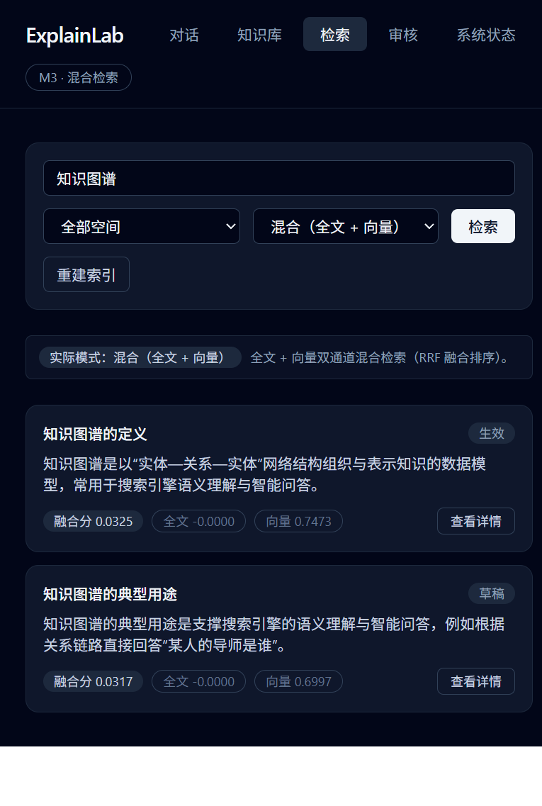
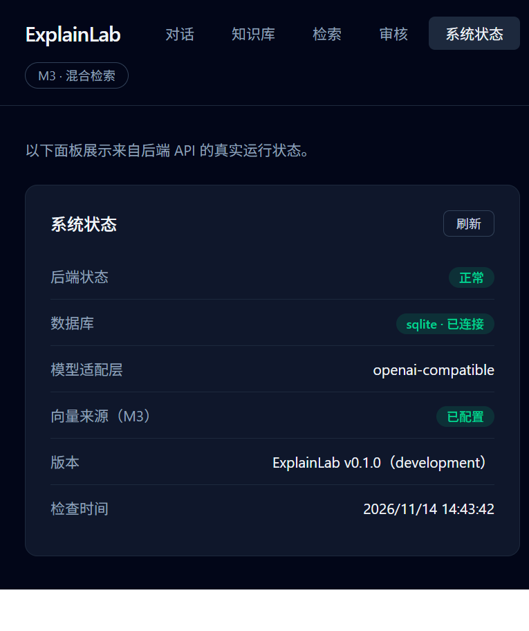

# M3 验收报告 · 跨会话混合检索

- 日期：2026-11-14
- 阶段：M3（检索层）
- 结论：**通过**。SQLite FTS5 全文（trigram 中文）+ 真实语义向量（SiliconFlow `BAAI/bge-m3`）+ RRF 融合排序全部完成；跨会话/跨空间检索 API 与前端「检索」页签真实可用；索引随治理变更同步、backfill 可用、embed 能力如实上报与降级。检索编排落在独立 Knowledge Core。已用真实 embed 端点对存量 3 条知识建向量并验证「全文 + 向量」双通道命中与融合排序。前后端、数据库、迁移、测试均实际运行验证。

## 1. 范围与目标

按 MILESTONES.md 与 [M3 实施计划](../plans/M3-plan.md)，M3 在 M2 治理之上提供检索层：

1. SQLite FTS5 全文索引（中文 trigram + 短查询 LIKE 回退）与向量存储/检索。
2. 混合融合排序（RRF，k=60），跨会话/跨知识空间。
3. 检索 API（`GET /api/search`、`POST /api/search/reindex`）+ 健康上报 embed 能力。
4. 前端最小「检索」页签（查询框 + 空间筛选 + 模式选择 + 结果通道/融合分 + 详情）。
5. 索引随治理变更同步 + backfill；PostgreSQL 阶段迁移方案（仅文档化，不实施）。

关键供应商约束与决策：**DeepSeek 无 `/embeddings`**，故向量来源采用已确认的**方案 A**——独立 `EMBED_*` 配置接入支持 embed 的供应商。本次选用 **SiliconFlow（硅基流动）`BAAI/bge-m3`**（非 Pro，官方价格页免费；1024 维）。聊天仍走 DeepSeek，二者互不影响。未提前开发 M4 地图 / M5 实验；未实际安装 PostgreSQL / pgvector。

## 2. 任务完成清单

| # | 任务 | 状态 | 证据 |
|---|---|---|---|
| T1 | 端口 + 迁移 0004（FTS 虚表/触发器 + 向量表） | ✅ | `FullTextIndex`/`VectorStore`/`Embedder` 端口；`knowledge_fts`(trigram)+3 触发器+`knowledge_vector`；head=0004 无漂移（§3.2） |
| T2 | Core HybridRetrievalService + RRF + Embedder 协议 | ✅ | `retrieval/` 实现 M0 `RetrievalService` 抽象，RRF k=60，channels 扩展（§3.1） |
| T3 | Backend SQLite FTS/Vector + 索引同步 + backfill | ✅ | FTS 触发器自动同步；向量 `sync_index` 钩子；`reindex_all` backfill（§3.1、§5） |
| T4 | embed 来源装配 + 能力探测 + 配置 | ✅ | `build_embed_adapter`/`get_embedder`/`probe_embed_capability`；`EMBED_*` 仅 backend/.env（§3.5） |
| T5 | search/reindex API + 健康上报 | ✅ | `GET /api/search`(hybrid/fts/vector)、`POST /api/search/reindex`、health `embed_adapter`（§4） |
| T6 | Frontend 检索页签 | ✅ | SearchView：查询/空间/模式/重建索引/能力横幅/通道与融合分/详情（§3.6） |
| T7 | 全量测试 + lint + 构建 + 无漂移 | ✅ | Python 149 + 前端 36 + ruff + build + alembic 无漂移 + Core 独立性（§3.3、§3.4） |
| T8 | 真实联调 + 验收报告 + MILESTONES + 提交 | ✅ | SiliconFlow 真实双通道证据（§3.5）+ 本报告 + MILESTONES M3 ✅ + Git 提交 |

## 3. 实际运行证据

### 3.1 Knowledge Core（独立于前端与 Web 框架）

检索编排落在独立包 `knowledge-core` 的 `retrieval/`（仅 Pydantic + 纯 Python），经端口依赖索引/向量存储，可复用于 Nesti：

- **端口（`ports.py`）**：`FullTextIndex`(upsert/remove/search)、`VectorStore`(upsert/remove/query)、`Embedder`(embed)，均为 Protocol；复用 M0 `RetrievalService.search(query, space_id, limit)` 签名不变。
- **`HybridRetrievalService`**：并行取 FTS top-K 与向量 top-K → **RRF** 融合 `score = Σ_channel 1/(k+rank)`（k=60），按 item_id 去重，返回 top-limit；`SearchResult` 向后兼容扩展 `channels`/`title`/`space_id`/`status`。`space_id=None` 跨全部空间（个人总知识库聚合 `space_id=None` 条目，沿用 M1 语义）；限定 space 时过滤；`status=archived` 默认不参与结果。
- **独立性守护**：子进程导入闭包测试扩展到 M3 `retrieval/` 模块，证明核心不依赖 fastapi/starlette/flask/django。

Backend 提供 SQLite 实现（`app/services/retrieval.py`）：`SQLiteFullTextIndex`（≥3 字符走 FTS5 trigram `MATCH` + `bm25()` 排序；<3 字符回退 `LIKE '%q%'`，真实子串匹配不造假）、`SQLiteVectorStore`（JSON 存向量 + Python 余弦）、`RetrievalIndexer`（FTS upsert + embed 建向量）、`sync_index`（治理变更钩子）、`reindex_all`（backfill）、`probe_embed_capability`（只读探测）。

### 3.2 数据库迁移

```
$ cd backend && uv run alembic current
0004_m3_retrieval (head)

$ uv run alembic check
No new upgrade operations detected.   # ORM 与迁移无漂移
```

M3 新增（`0004_m3_retrieval`）：

| 对象 | 说明 |
|---|---|
| `knowledge_fts` | FTS5 虚表 `(item_id UNINDEXED, title, content, tokenize='trigram')`，中文子串 MATCH |
| 触发器 ×3 | `knowledge_item_ai/au/ad`：INSERT/UPDATE(title,content)/DELETE 自动同步 FTS（rowid 对齐） |
| `knowledge_vector` | `item_id PK FK→knowledge_item CASCADE, model, dim, vector(JSON Text), updated_at` |

**FTS 双路径 bootstrap**：迁移 0004 与 `Base.metadata.create_all`（API 测试夹具）共用单一 `FTS_DDL` 源（`app/db/fts.py`，`IF NOT EXISTS` 幂等）；`create_all` 经 `after_create` 事件（target=MetaData，仅触发一次）建 FTS，Alembic 用独立 MetaData 不会重复触发。加上 M1/M2 的 8 张表，当前共 9 张表 + 1 虚表。

### 3.3 Python 测试与 lint

```
$ uv run pytest backend/tests knowledge-core/tests
149 passed in 19.13s        # backend 74 + knowledge-core 75

$ uv run ruff check backend knowledge-core
All checks passed!
```

覆盖（M3 新增）：Core RRF 融合单测、HybridRetrievalService（InMemory FTS/Vector/Embedder）、space 过滤与 archived 排除、Embedder 协议契约、独立性闭包扩展；Backend trigram 中文 MATCH、短查询 LIKE 回退、触发器同步、向量 upsert/remove/query 余弦、`reindex_all` backfill、`sync_index` 增删与失败降级、`probe_embed_capability` 三态、search API 三模式 + 空查询 422 + 未知 space 404 + archived 排除 + hybrid 双通道 + unsupported 降级、reindex backfill、health `embed_adapter`。

### 3.4 前端测试与构建

```
$ npm run test
Test Files  6 passed (6)   Tests  36 passed (36)
  client.test.ts 18 · ChatView 3 · KnowledgeView 4 · ReviewQueue 4 · HealthPanel 2 · SearchView 5

$ npm run build   # tsc -b && vite build
通过（Tailwind 真实生成，无类型错误）
```

M3 新增前端测试：SearchView 渲染/检索/模式切换/通道与融合分/详情展开；API 客户端 search/reindex/getKnowledge 与 `embed_adapter` 字段；HealthPanel 向量来源行。

### 3.5 真实 embed 端到端联调（服务实际运行中）

向量配置：`EMBED_BASE_URL=https://api.siliconflow.cn/v1`、`EMBED_MODEL=BAAI/bge-m3`，密钥仅存 `backend/.env`（gitignore）。复用 `OpenAICompatibleAdapter`（`trust_env=False` 直连真实 base_url，无代理替换）。聊天配置（DeepSeek）不变。

干净 UTF-8 证据留存于 [assets/m3-evidence.txt](assets/m3-evidence.txt)，关键结果：

**① 能力探测（只读，真实端点）**：

```
$ uv run python backend/scripts/probe_embed.py
embed 能力: supported
端点: https://api.siliconflow.cn/v1  模型: BAAI/bge-m3
向量维度: 1024
```

**② 健康上报 + 重建索引（真实 bge-m3 向量）**：

```
GET /api/health            -> embed_adapter: "configured"
POST /api/search/reindex   -> {"indexed":3,"embed_capability":"supported"}   # 存量 3 条全部建向量
```

**③ 混合检索双通道 + RRF 融合（查询「知识图谱」）**：

```
GET /api/search?query=知识图谱&mode=hybrid -> embed_capability: "supported", count: 2
  #1 知识图谱的定义   active  score=0.0325224749  channels={fts:-1.34e-6, vector:0.7469}
  #2 知识图谱的典型用途 draft  score=0.0317460317  channels={fts:-1.33e-6, vector:0.6992}
  归档条目 b54c600f… 未出现（查询期排除）
```

融合分核对（RRF k=60）：active = 1/62(fts) + 1/61(vector) = 0.0325224749；draft = 1/63 + 1/63 = 0.0317460317，与返回一致。对照模式：`mode=fts` 仅 fts 通道（bm25）、`mode=vector` 仅 vector 通道（余弦 0.747/0.699），均真实返回。

**④ 降级如实**：embed 未配置 → `not_configured` 且 hybrid/vector 自动回退仅全文；embed 调用失败 → `unsupported` 回退仅全文（`test_search.py` 覆盖）；`mode=fts` 不探测 embed，上报 `configured`。全程不造假、不冒充语义。

> 说明：证据中查询词以 UTF-8 百分号编码传递（`%E7%9F%A5…`），以规避 Windows 控制台码页对中文 argv 的转码；浏览器端 fetch 天然 UTF-8，不受影响。

### 3.6 浏览器实测

浏览器打开 http://[::1]:5173 （Vite 8 仅绑定 IPv6），新增「检索」页签真实渲染，数据均来自后端真实 API：

- **检索页签**：查询框「知识图谱」+ 空间筛选（全部空间/个人总知识库）+ 模式选择（混合/仅全文/仅向量）+「检索」「重建索引」按钮；能力横幅显示「实际模式：混合（全文 + 向量）· 全文 + 向量双通道混合检索（RRF 融合排序）」；结果列表每条含标题/状态徽章/snippet/**融合分**/**全文通道分**/**向量通道分**/「查看详情」（展开 M2 治理详情）。
- **系统状态页签**：新增「向量来源（M3）」行显示「已配置」，与 health `embed_adapter` 一致。





## 4. Backend API（新增 / 调整）

新增（`app/api/routes/search.py`）：

- `GET /api/search?query=&space_id=&limit=&mode=`：mode=hybrid|fts|vector；query 必填（min_length=1，空 422）；limit 1–100 默认 20；未知 space 404；返回 `query/mode/count/embed_capability/results[]`（每条含 item_id/score/snippet/title/space_id/status/channels）。embed 未配置或失败时如实降级仅全文并上报 capability。
- `POST /api/search/reindex`：backfill/重建索引（先探测 embed 能力），返回 `indexed/embed_capability`。

调整：`GET /api/health` 增加 `embed_adapter`（configured/not_configured，配置态、不发网络请求，与 `model_adapter` 同风格）。

## 5. 索引同步与降级

- **FTS**：SQLite 触发器随条目 INSERT/UPDATE/DELETE 自动同步，无需应用层干预。
- **向量**：治理变更钩子 `sync_index` 在 create/update/extract/restore/merge/delete 及审核批准后重算或移除向量；embed 失败仅告警降级（FTS 兜底），不阻断业务、不造假。
- **backfill**：`reindex_all` 遍历存量条目建索引，单条 embed 失败跳过并告警，FTS 仍兜底。
- **能力上报**：`probe_embed_capability` 三态（not_configured/supported/unsupported）；search 依此决定 effective_mode 并如实返回。

## 6. PostgreSQL 阶段迁移方案（文档化，不实施）

- FTS5 → PG `pg_trgm`（与 trigram 对齐，免分词依赖，推荐）或 `tsvector`+zhparser/pg_jieba。
- 向量表 → `pgvector`（`vector(dim)` + HNSW），余弦下推 SQL。
- 端口不变，仅换 Backend 实现；迁移脚本与方言开关随部署阶段提供。本阶段未安装 PG/pgvector。

## 7. 架构约束遵守情况

- Knowledge Core 仍为独立 Python 包（仅 Pydantic + httpx）；检索编排经端口依赖索引/向量存储，不依赖前端页面，可复用于 Nesti（独立性闭包守护扩展到 M3）。
- 模型/向量供应商仅通过 Model Adapter 接入，可替换（聊天 DeepSeek、向量 SiliconFlow 各自独立配置）；核心不读密钥环境变量。
- API Key（含 EMBED_API_KEY）仅存 `backend/.env`（gitignore），前端无任何密钥。
- 所有展示数据来自真实 API 与真实 embed 输出，无假数据；未配置/失败均如实上报与降级。
- 请求只发往真实 base_url（`https://api.siliconflow.cn/v1` / `https://api.deepseek.com/v1`），`trust_env=False`，无代理替换。
- 未删除工作区任何已有文件；未擅自改变技术架构；未提前开发 M4/M5。

## 8. 开发/联调中发现并修复的问题

1. **FTS bootstrap 事件目标误判**：`after_create` 挂在 `Base.metadata` 上时 target 为 MetaData（仅触发一次），早期按「每表」处理导致 `'MetaData' object has no attribute 'name'`。修复：handler 改为 `if "knowledge_item" in target.tables: create_fts(...)`，并与迁移共用幂等 `FTS_DDL`。
2. **LIKE 回退重复参数键**：短查询回退分支误用 `{"l": like, "l": limit}`（ruff F601 暴露的真实缺陷）。修复：参数改名 `:pat`/`:lim`。
3. **unsupported 降级未改 effective_mode**：embed 调用失败回退仅全文时返回 mode 仍为 hybrid。修复：except 分支置 `effective_mode="fts"`，与 capability 一致。
4. **证据捕获码页问题（非产品缺陷）**：Windows 控制台对 curl 中文 argv 转码导致查询乱码、全文通道空命中。改用显式 UTF-8 百分号编码重跑，双通道真实命中；浏览器端不受影响。

## 9. Git

- 本次提交包含：Knowledge Core 检索端口/RRF/HybridRetrievalService、后端 FTS/向量实现/索引同步/backfill/能力探测/search 路由/DTO/health 上报/迁移 0004、前端检索页签与 API 客户端、全量测试、M3 验收报告与截图与证据、M3 计划、MILESTONES.md 更新。
- 忽略项：`.venv/`、`node_modules/`、`dist/`、`data/`、`.env`、缓存等（`.env` 绝不入库）；临时联调 json 不入库。

## 10. 已知限制与遗留事项（不影响 M3 验收）

1. 开发期向量余弦在 Python 内对候选集计算（本地规模足够）；PG 阶段换 pgvector 下推。
2. archived 条目在融合后过滤：返回集合与相对排序正确，但返回分数中的 rank 含归档占位（如 fts 1/62 而非 1/61）。属分数口径细节，不影响「归档不检索」与排序正确性。
3. 向量质量依赖 embed 模型；`BAAI/bge-m3` 免费档有速率限额，大规模 backfill 需留意限流。
4. 知识地图（React Flow / ELK.js）属 M4，交互实验属 M5，本阶段未提前开发。

## 11. 验收结论

M3 全部任务（T1–T8）完成并经实际运行与真实 embed 端到端验证：中文全文（trigram + 短查询回退）与真实语义向量可用、RRF 融合排序正确、跨会话/跨空间检索 API 与前端检索入口真实可用、space 过滤与 archived 排除正确、索引随治理变更同步、backfill 可用、embed 能力如实上报与降级，架构约束全部满足，全量测试 + lint + 构建 + 无漂移 + Core 独立性通过。**建议通过验收，进入 M4。**