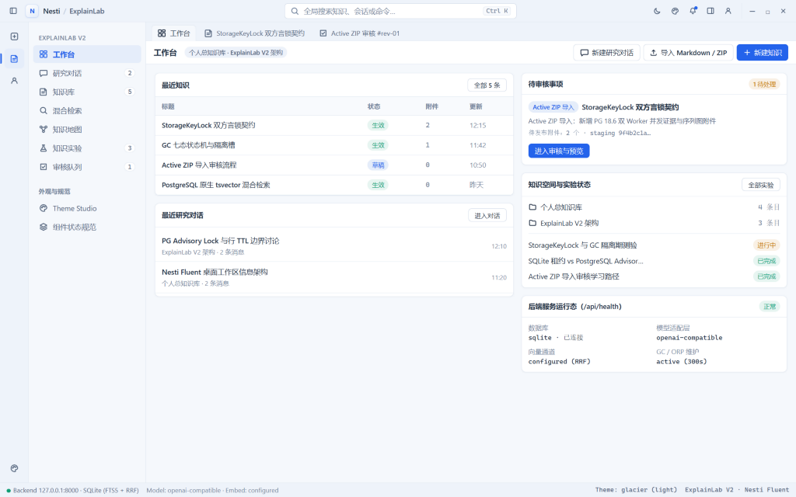

# 03 · Workspace Shell 设计规范

## 1. 十大区域与架构归属边界

| # | 区域 | 尺寸规范 | 归属边界 | 说明 |
| --- | --- | --- | --- | --- |
| 1 | 应用标题栏（Titlebar） | 高 `40px` | **Nesti Workspace Shell** | 承载折叠按钮、品牌槽、全局搜索、主题/通知/检查器开关与 Windows 窗口控制 |
| 2 | Nesti 品牌图标槽 | `24×24` | **Nesti Workspace Shell** | 原版蓝白 Logo 永久免疫染色，旁接 `Nesti / ExplainLab` 面包屑 |
| 3 | 全局搜索（Command Bar） | 居中最大 `420px` | **Nesti Workspace Shell** | 快捷键 `Ctrl+K`，支持跨模块命令与 ExplainLab 知识直达 |
| 4 | 通知入口 | 顶栏右侧 `28×28` | **Nesti Workspace Shell** | 聚合待审核计数红点（调用 `GET /api/reviews?status=pending`） |
| 5 | 用户与设置入口 | 顶栏右侧 `28×28` | **Nesti Workspace Shell** | 本地工作区身份与 Theme Studio 快捷入口 |
| 6 | 左侧主导航（Primary Rail） | 宽 `52px` | **Nesti Workspace Shell** | 切换 Nesti 生态模块（Desktop Hub / ExplainLab / Agent Center / Theme Studio），激活态左侧 `3px` 钴蓝指示条 |
| 7 | 当前模块次级导航（Subnav） | 宽 `212px`，可折叠 | **ExplainLab 模块** | 7 个业务视图 + 实时计数角标，窄窗或专注模式可一键隐藏 |
| 8 | 多标签栏 + 主工作区 | `flex: 1` 自适应 | **ExplainLab 模块** | 顶置 `34px` 多标签条支持扩展多文档/审核并行标签，下方承载单页工具栏与工作区 |
| 9 | 可折叠右侧检查器 | 宽 `320px`，按需显示 | **ExplainLab 模块** | 仅在知识库、知识地图、研究对话、审核等上下文页面按需展开；工作台/检索/实验/Theme Studio 默认不强制占用 |
| 10 | 底部状态栏（Status Bar） | 高 `26px` | **Nesti Shell + 模块插槽** | 左侧实时展示 `/api/health` 数据库与模型状态，右侧展示当前主题预设与模块版本 |

## 2. 窗口缩放与最小尺寸

- **推荐窗口尺寸**：`1280×800` 及 `1440×900`（高 DPI 125%–200% 清晰无锯齿）。
- **最小支持宽度**：`960px`（`min-width: 960px`）；在 `960px–1180px` 区间自动折叠右侧检查器或次级导航，确保主内容区始终 ≥ `560px`，绝不出现无意义留白或表头裁切。
