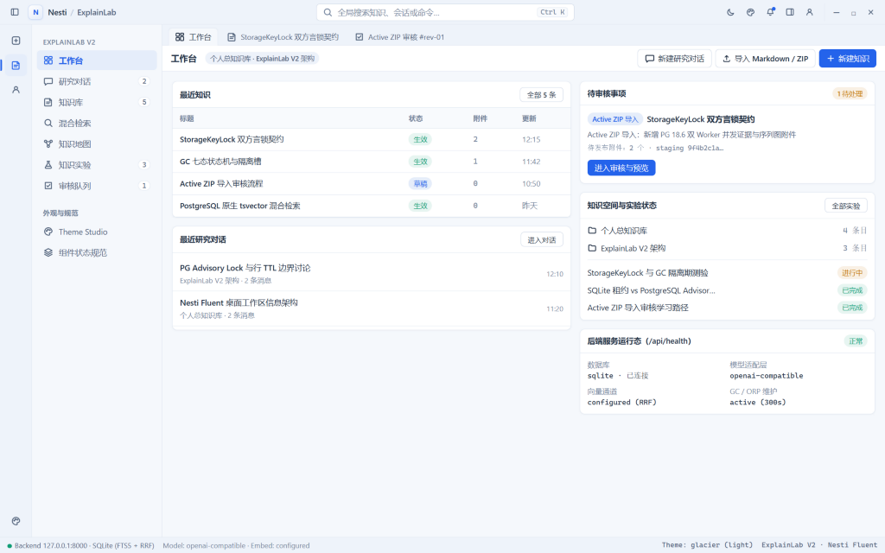

# 04 · 01 Dashboard（工作台）

## 1. 布局与设计理念

工作台定位为「桌面启动页与当日研究入口」，采用 **非对称双栏（`1.35fr : 1fr`）** 信息密度布局，**零虚假 KPI 卡片**，全部区块严格由真实后端 API 驱动：

- **顶部工具栏**：当前工作空间提示 + 三项高频快捷操作（新建研究对话、导入 Markdown/ZIP、新建知识）。
- **左栏（主内容流）**：
  1. **最近知识**（紧凑数据表：`标题 / 状态 / 附件数 / 更新时间`，源自 `GET /api/knowledge`，点击行直达知识库并打开检查器）。
  2. **最近研究对话**（会话标题、所属空间、消息数、更新时间，源自 `GET /api/conversations`）。
- **右栏（治理与运行态）**：
  1. **待审核事项**（源自 `GET /api/reviews?status=pending`，高亮 V2 Active ZIP 导入单与待发布附件数，一键进入审核）。
  2. **知识空间与实验状态**（源自 `GET /api/spaces` 与 `GET /api/experiments/sessions`，展示真实条目数与进行中/已完成实验）。
  3. **后端服务运行态**（源自 `GET /api/health`，如实展示数据库方言、模型适配层、向量通道与 GC/ORP 维护态）。

## 2. 右侧检查器策略

工作台默认**不展开**右侧检查器，将水平空间完整留给双栏工作区，避免信息挤压。
