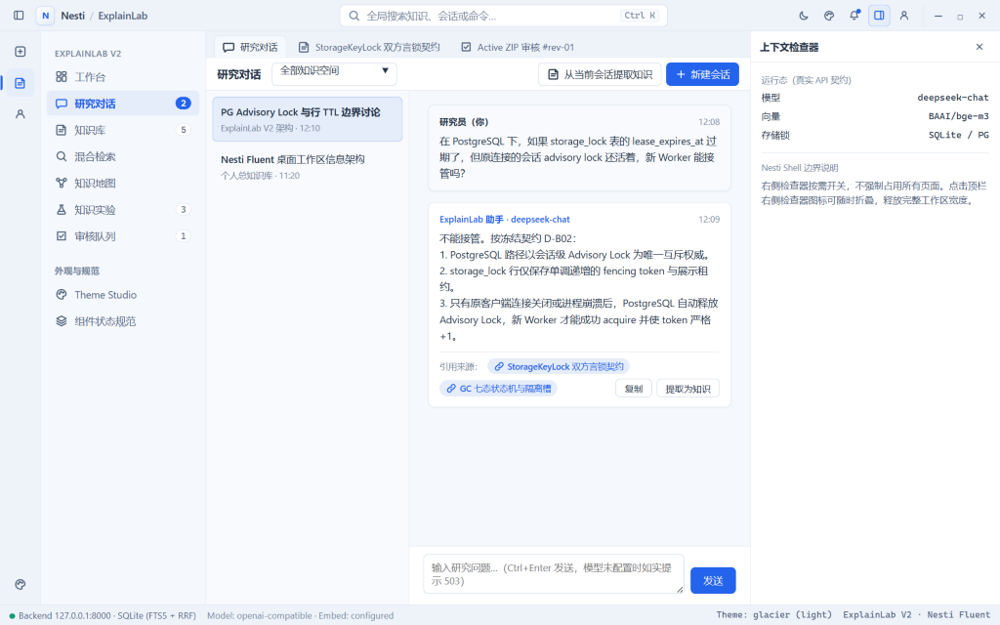

# 05 · 02 Chat（研究对话）

## 1. 专业研究助手定位

摒弃气泡式消费级 AI 聊天模板，采用 **三栏研究工作台（左会话列表 `260px` + 中文档级对话流 + 右可折叠上下文检查器 `320px`）**：

- **顶部工具栏**：知识空间筛选下拉（补齐 `GET /api/conversations?space_id=` 前端缺口）、一键「从当前会话提取知识」（`POST /api/conversations/{id}/extract`）与「新建会话」。
- **左栏（会话列表）**：展示标题、所属空间与更新时间；支持删除前二次确认，避免误删。
- **中栏（研究对话流）**：
  - 每条消息以结构化文档块呈现（角色标签、真实模型名、时间戳、正文 Markdown 渲染）。
  - 助手回复底部内嵌 **引用来源芯片** 与 **消息操作条**（复制、提取为知识）。
  - 底部输入区支持多行研究问题与 `Ctrl+Enter` 发送；模型未配置时如实呈现 `503` 指引横幅，绝不假装响应。
- **右栏（可折叠检查器）**：展示当前会话关联上下文、后端模型/向量实时运行态与后续可扩展的会话引用清单。
