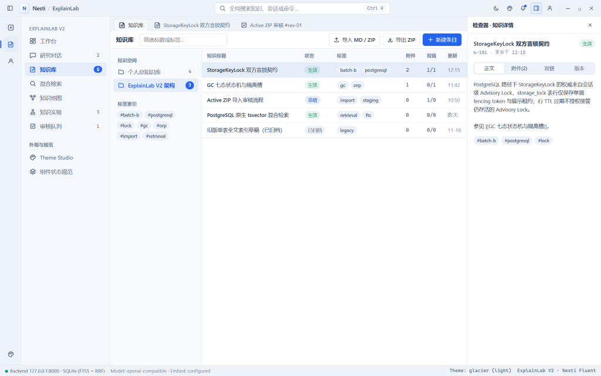
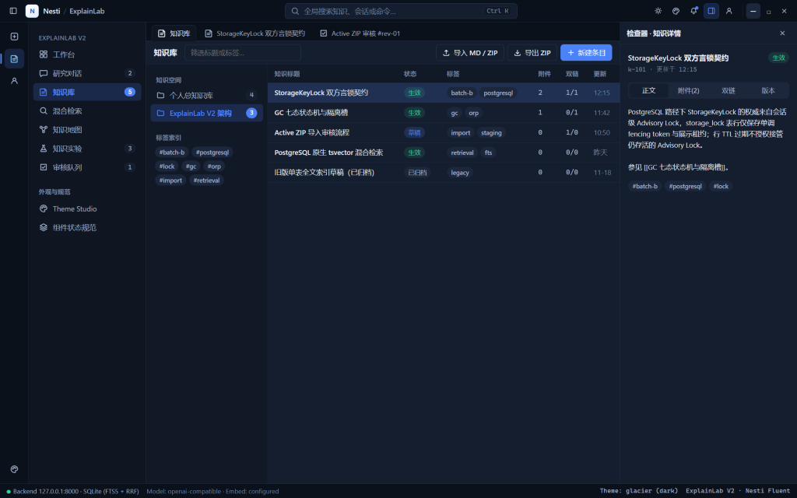

# 06 · 03 Knowledge（知识库工作区）

## 1. 文件管理器 + 知识工作区融合布局

采用三栏桌面文件管理器结构（左空间与标签目录 `220px` + 中密集数据表 + 右可折叠详情检查器 `320px`）：

- **顶部工具栏**：标题/标签即时过滤框、**导入 MD / ZIP**（接入 `POST /api/knowledge/import` 与 `/import/batch`）、**导出 ZIP**（接入 `POST /api/knowledge/export`，明确 `include_attachments=false` 契约）、**新建条目**。
- **左栏（知识目录）**：知识空间列表（个人总知识库 / 项目空间）+ 实时条目计数 + 标签索引快捷筛选。
- **中栏（密集知识表）**：列为 `知识标题 / 状态 / 标签 / 附件 / 双链(出/反) / 更新时间`，单行紧凑不折行，支持键盘上下键切换选中行。
- **右栏（详情检查器 — 4 分区 Tab）**：
  1. **正文**：Markdown 渲染预览、状态切换、编辑与单篇导出（`GET /api/knowledge/{id}/markdown`）。
  2. **附件**：列表（`GET .../attachments`）、下载（`GET .../attachments/{att_id}` 流式下载）、删除（`DELETE`，最后引用触发 GC 提示）、上传（JSON Base64，`≤10 MiB`，8 类 MIME 白名单，禁止 SVG；归档条目禁用上传并提示 `ATTACHMENT_ITEM_ARCHIVED`）。
  3. **双链**：出链（`GET .../links`）与反向链接（`GET .../backlinks`），支持点击跳转。
  4. **版本与治理**：版本快照与回滚（`POST .../versions/{v}/restore`，`202` 自动提示进入审核）、关系列表与查重分析。
