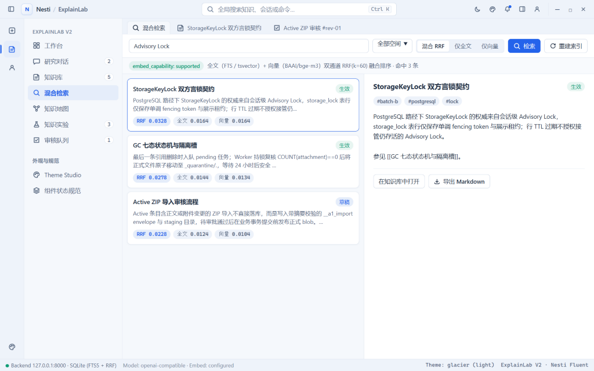

# 07 · 04 Search（混合检索）

## 1. 布局与信息层级

检索页采用 **顶部命令工具条 + 能力状态条 + 左右分栏（结果列表 `1.05fr` : 实时详情预览 `1fr`）**，不强制占用额外右侧检查器：

- **检索工具条**：宽幅搜索输入框 + 空间筛选 + 模式分段控件（`混合 RRF` / `仅全文` / `仅向量`）+ `检索` 主按钮 + `重建索引`（`POST /api/search/reindex`）。
- **诚实能力条**：直接映射后端 `SearchResponse.embed_capability`（`supported` / `not_configured` / `unsupported`），如实告知当前是 FTS+Vector 双通道 RRF(k=60) 还是自动降级为仅全文。
- **左栏（排序结果列表）**：展示标题、状态徽章、匹配摘要、以及等宽字体的融合分与各通道分（`RRF` / `全文` / `向量`）。
- **右栏（实时详情预览）**：点击左侧任一命中条目即在右侧呈现完整正文、标签与快捷动作（在知识库中打开 / 导出单篇 Markdown）。
