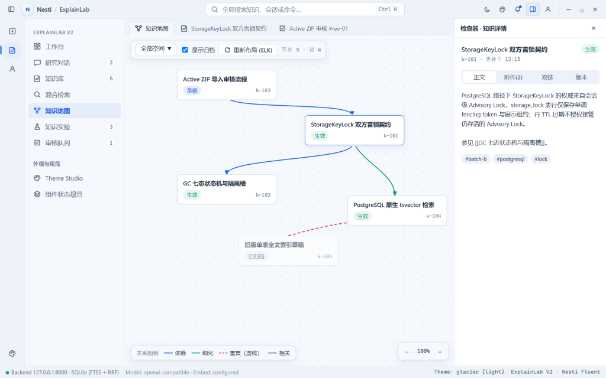

# 08 · 05 Knowledge Map（知识地图）

## 1. 画布优先原则（`@xyflow/react` + `elkjs`）

严格遵循「保留画布为视觉中心，UI 面板绝不占据画布核心」：

- **全幅点阵画布（80%+ 视口面积）**：自适应剩余高度（修复旧版固定 `h-[480px]` 问题），背景使用语义变量 `--nf-graph-grid` 渲染浅/深双主题点阵。
- **浮动毛玻璃工具条（左上角，仅 `38px` 高）**：空间筛选、「显示归档」开关、「重新布局 (ELK)」按钮与节点/边计数。
- **准确的关系图例（左下角）**：全部使用真实 SVG `<line>` 绘制，彻底修复旧版 `重复（虚线）` 渲染为实线块的缺陷；颜色全部绑定 `--nf-graph-edge-*` 令牌。
- **缩放控件（右下角）**：紧凑 `− / 100% / +` 控件条，样式与 Nesti Fluent 浅/深主题完全一致。
- **点击节点联动右侧检查器**：未选中节点时可关闭检查器获得最大画布；点击任意节点后右侧滑出 320px 知识详情检查器（正文/附件/双链/版本），编辑或治理后自动重拉 `/api/graph` 并重新 ELK 布局。
