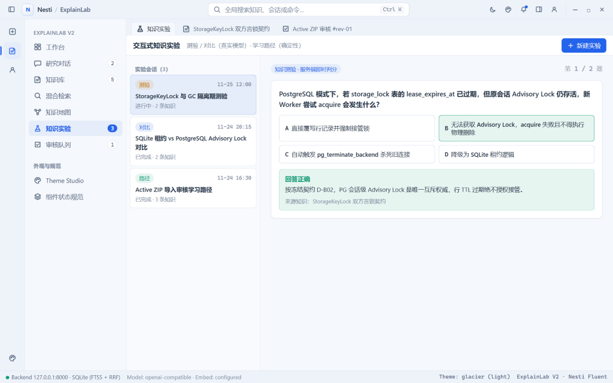

# 09 · 06 Experiments（交互式知识实验）

## 1. 布局与真实数据契约

实验页采用 **左实验会话列表（`280px`）+ 中央专注执行工作区**，绝不虚构学习率、掌握度雷达图等后端不存在的指标：

- **左栏（实验会话与模式筛选）**：按时间倒序列出真实实验历史（`GET /api/experiments/sessions`），清晰区分三类模式徽章（`测验` 琥珀 / `对比` 钴蓝 / `路径` 翡翠）与 `进行中 / 已完成` 状态，支持一键重新打开或删除。
- **中央执行工作区（三类 Runner）**：
  1. **QuizRunner（知识测验）**：逐题作答、服务端即时判分（`POST .../answer`）、解析与来源知识直达；完成后经 `POST .../complete` 渲染 SVG 得分环与逐题回顾。
  2. **CompareRunner（知识对比）**：顶置关系判定卡片 + 并排双栏知识对比 + 结构化相同点/不同点列表（空时如实提示）。
  3. **ChainRunner（学习路径）**：沿 `depends_on / refines` 确定性 DFS 编排的竖向步进器（无需模型，标明终点目标知识）。
- **新建实验弹窗/面板**：保留真实约束校验（测验 ≥1 条、对比 =2 条、路径选 1 条终点），模型未配置时如实提示 503。
