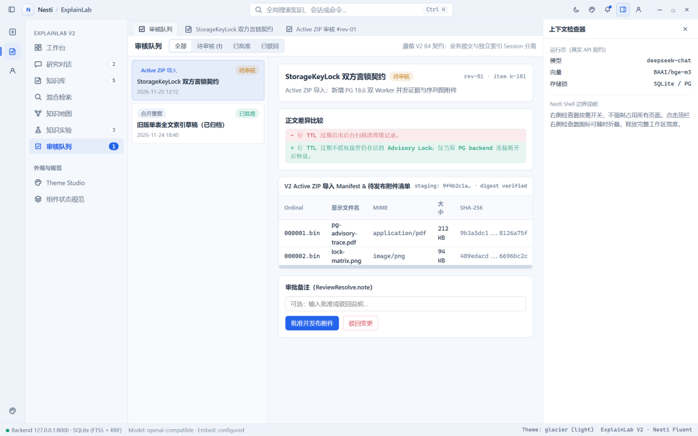

# 10 · 07 Reviews（审核队列与 V2 Active ZIP 导入审批）

## 1. Master-Detail 审批工作台

针对 V2 Batch B4 的 **Active ZIP 导入审核** 做了深度桌面化设计，采用 **左筛选队列（`290px`）+ 中央差异与附件清单工作区 + 右侧审计上下文检查器**：

- **左栏（审核队列）**：顶部四态分段筛选（`全部` / `待审核` / `已批准` / `已驳回`），卡片明确区分 `Active ZIP 导入` 与普通 `编辑 / 删除 / 合并 / 回滚` 审核单。
- **中央审批主区**：
  1. **审核抬头**：条目标题、单行状态徽章、Review ID 与目标 Item ID、提交理由。
  2. **正文差异比较（Diff View）**：等宽字体红绿增删行对比，替代旧版仅截断 40 字的纯文本摘要。
  3. **V2 Active ZIP Manifest & 待发布附件清单**：解析 `payload.__a1_import`，展示 `staging_id`、摘要校验态与带横向滚动保护的附件表格（`Ordinal` / `显示文件名` / `MIME` / `大小` / `SHA-256`）。
  4. **审批动作区**：补齐 `ReviewResolve.note` 备注输入框；「批准并发布附件」与「驳回变更」按钮遵循真实后端契约（业务提交与独立索引 Session 分离；驳回仅清理可证实归属的 staging）。
