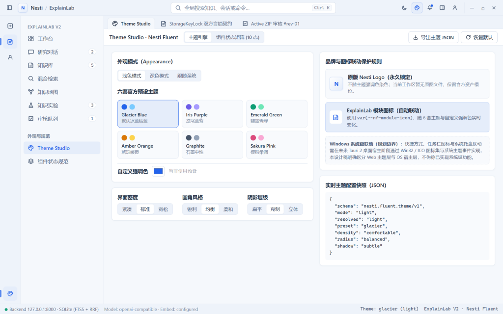
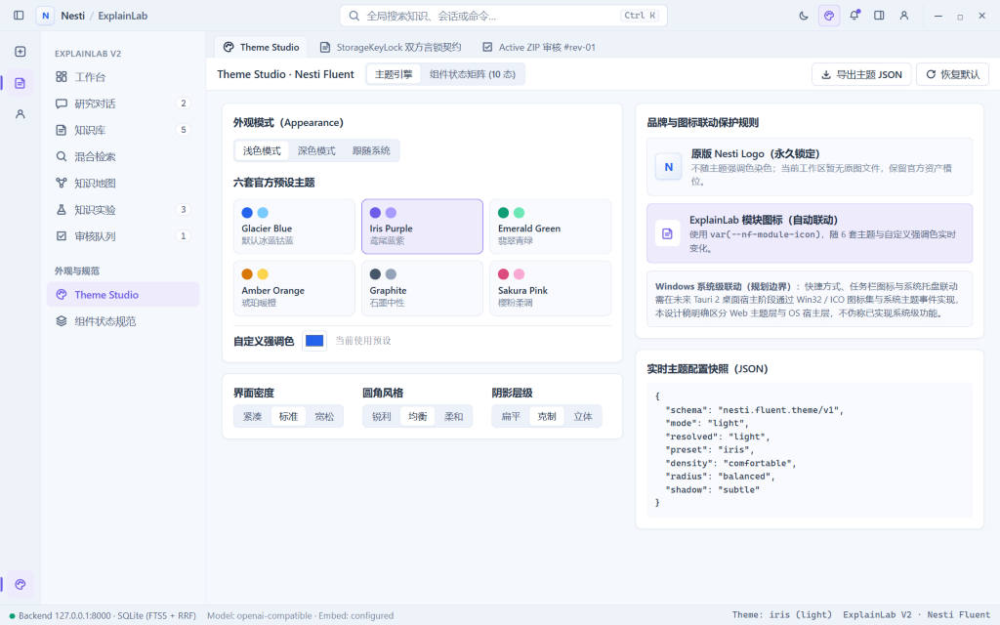
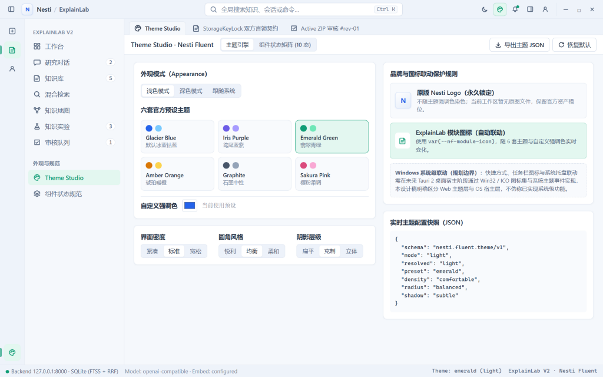
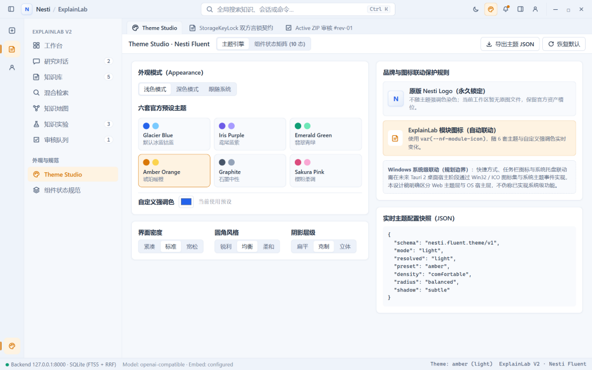
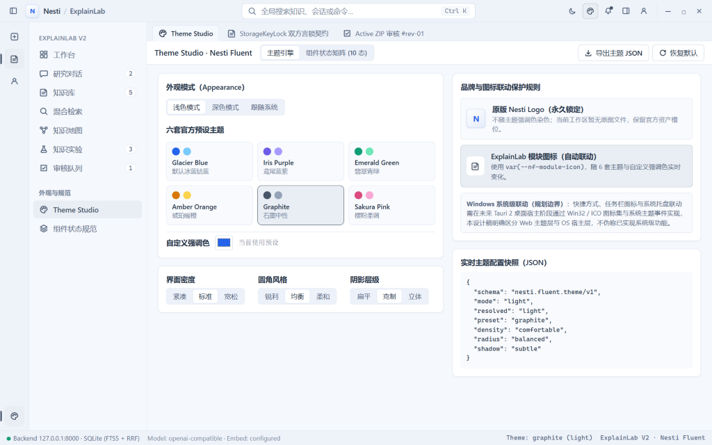
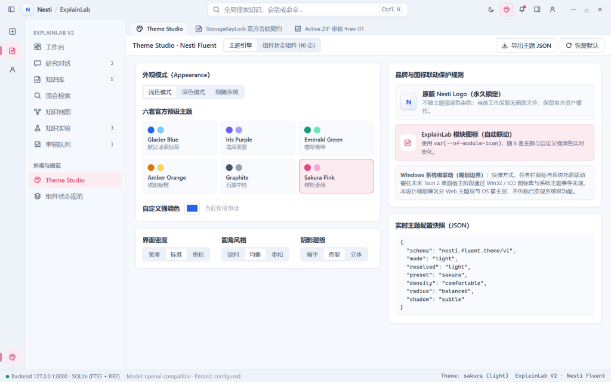

# 11 · Theme Studio（动态主题引擎）

## 1. 六套官方预设主题实机渲染预览

| Glacier Blue（默认） | Iris Purple | Emerald Green |
| --- | --- | --- |
|  |  |  |

| Amber Orange | Graphite | Sakura Pink |
| --- | --- | --- |
|  |  |  |

## 2. 核心能力清单（全部 12 项）

1. **外观模式**：浅色（`light`）、深色（`dark`）、跟随系统（`system`，监听 `prefers-color-scheme`）。
2. **六套预设主题**：Glacier Blue / Iris Purple / Emerald Green / Amber Orange / Graphite / Sakura Pink，均提供浅色与深色两套对比度校正色阶。
3. **自定义强调色**：原生取色器动态覆写 `--nf-accent` 与派生柔色/边框，实时预览。
4. **界面密度 / 圆角 / 阴影**：`compact | comfortable | spacious`、`sharp | balanced | soft`、`none | subtle | elevated` 三维正交组合。
5. **导入导出与恢复默认**：基于 `nesti.fluent.theme/v1` JSON Schema 导出/导入主题配置，支持一键恢复 Glacier Blue 浅色默认。

## 3. 品牌图标保护与 Windows 系统级联动边界

- **原版 Nesti Logo 永久不变**：位于标题栏与 Theme Studio 保护预览区，锁定原版蓝白特征，绝不随强调色染色。
- **ExplainLab 模块图标动态联动**：绑定 `--nf-module-icon`，随 6 套主题与自定义强调色平滑切换。
- **第三方应用原色保护**：未来 Nesti Desktop Hub 挂载的第三方工具图标默认保持原品牌色，不强制染色。
- **Windows 系统级联动（独立规划，不虚称已实现）**：任务栏图标、快捷方式 `.ico` 与系统托盘随主题联动属于未来 **Tauri 2 桌面宿主层**能力，需在桌面封装阶段通过 Win32 API / 多套预生成 `.ico` 资产与系统 `WM_SETTINGCHANGE` 事件实现，本轮仅定义接口与架构边界。
