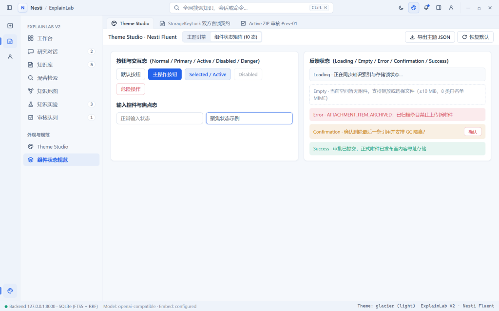

# 12 · Component Library（组件规范与 10 态矩阵）



## 1. 图标规范
- 统一采用 **16px / 15px 线性 SVG 图标（`stroke-width: 1.5px`，圆头端点）**，严禁使用 Emoji 充当正式 UI 图标。
- 普通功能图标使用 `currentColor`；模块主标识使用 `var(--nf-module-icon)`；原版 Nesti Logo 独立资产不染色。

## 2. 核心组件清单（覆盖 Design System §8–§19）
- **Buttons**：Default / Primary（`--nf-accent`）/ Selected-Active（`--nf-accent-soft` + `--nf-accent-border`）/ Danger / Disabled / Icon Button（`28×28`）。高度绑定 `--nf-control-height`（`26 / 30 / 34px`）。
- **Inputs & Selects**：1px `--nf-border-default` 边框，聚焦态 `--nf-accent` + `2px --nf-accent-subtle` 柔环；支持原生校验错误红框。
- **Menus & Segmented Controls**：紧凑 `24px` 分段切换条（用于搜索模式、审核筛选、检查器分区、Theme Studio 选项）与带快捷键提示的命令菜单。
- **Dialogs & Command Palette**：居中顶置 `540px` 浮层（`Ctrl+K`），`--nf-bg-overlay` 遮罩，`ESC` 或点击遮罩关闭；破坏性删除一律使用应用内确认对话框，取代旧版 `window.confirm`。
- **Tables**：粘性表头（`--nf-bg-surface-subtle`）、`--nf-row-height` 密度联动、全单元格 `white-space: nowrap` 配合容器 `overflow-x: auto`，彻底避免表头折行与徽章裁切。
- **Tabs / Navigation / Side Panels**：多标签栏（`34px`）、可折叠次级导航（`212px`）、可折叠右侧检查器（`320px`）。
- **Empty / Loading / Error / Confirmation / Success States**：全部以统一语义底色与 1px 边框呈现，并在 [15-components-states.png](screenshots/15-components-states.png) 中实机验证。

## 3. Theme Engine Contract（TypeScript 接口草图）

```ts
export interface NestiThemeConfig {
  schema: "nesti.fluent.theme/v1";
  mode: "light" | "dark" | "system";
  preset: "glacier" | "iris" | "emerald" | "amber" | "graphite" | "sakura" | "custom";
  customAccent?: string;
  density: "compact" | "comfortable" | "spacious";
  radius: "sharp" | "balanced" | "soft";
  shadow: "none" | "subtle" | "elevated";
}
```
